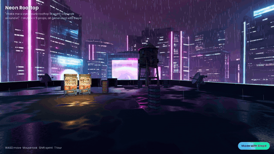
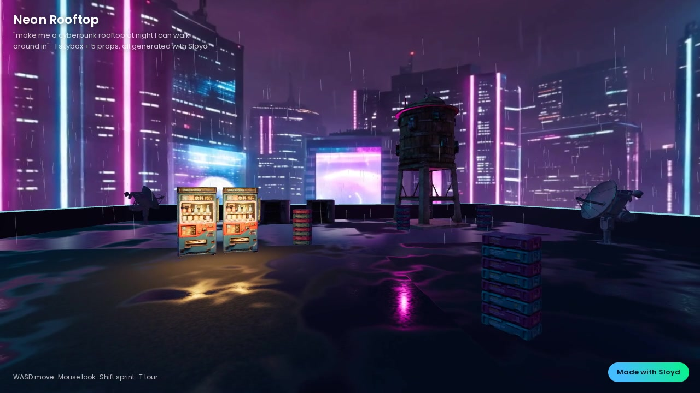
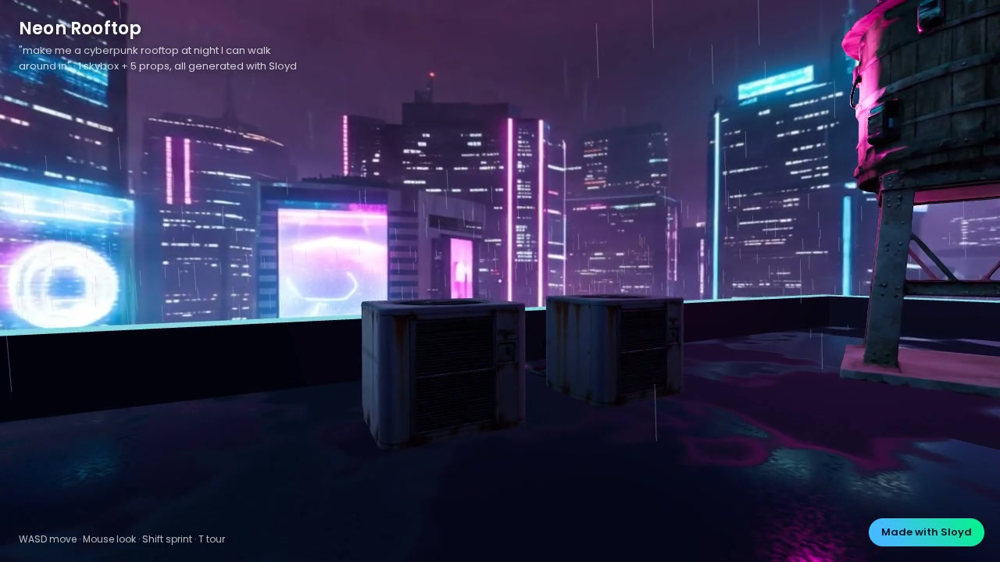
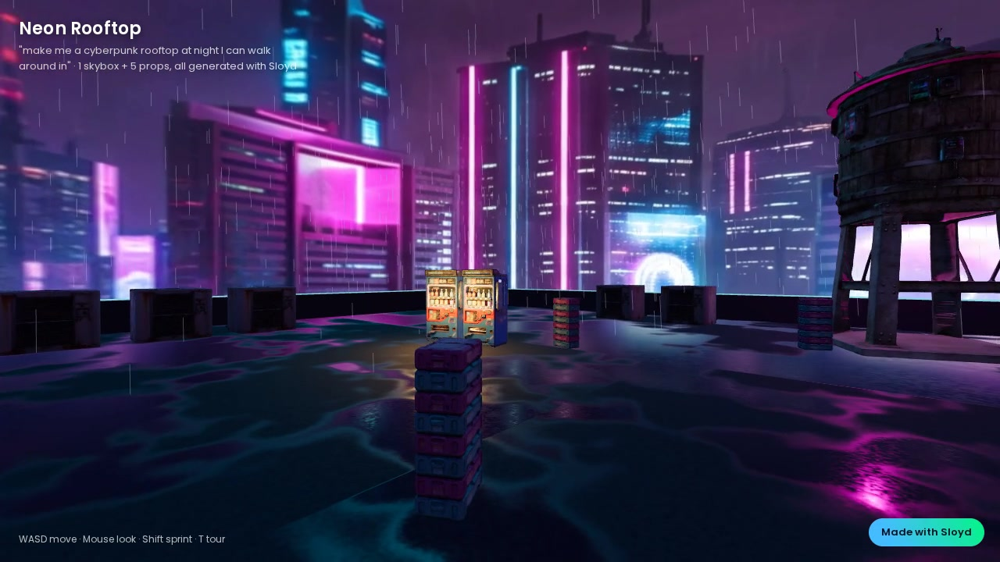

# Worldbuilding Team for Claude, by Sloyd

**Type a world. Walk around in it.**

Five Claude skills that work like a small environment-art team. You give them one sentence. They write a world bible, generate a 360 skybox and a matching set of 3D props with the [Sloyd API](https://www.sloyd.ai/api), and assemble everything into a walkable Three.js scene that opens in your browser. Export notes for Godot and Unity are included.



> *"make me a cyberpunk rooftop at night I can walk around in"*
> → [`examples/neon-rooftop/`](examples/neon-rooftop/): 1 Sloyd skybox + 5 Sloyd props (18 placed), 150 credits, about 6 minutes of generation. [Full walkthrough video (MP4)](examples/neon-rooftop/media/walkthrough-16x9.mp4)

For level designers blocking out a mood, VR developers who need a place to stand, filmmakers doing previs, and game developers who want a playable vertical slice before lunch.

## The team

| Skill | Role | Sloyd tools |
|---|---|---|
| [`world-director`](skills/world-director/SKILL.md) | Writes the **world bible**: biome, era, time of day, weather, mood, 5-colour lighting palette, one art style, foreground/midground/background composition, landmark and prop list with real sizes in metres | `get_generation_styles`, `get_credit_balance` |
| [`sky-artist`](skills/sky-artist/SKILL.md) | Paints the **360 skybox**, makes day/night/weather variants by editing, or expands concept art into a full panorama | `generate_skybox`, `edit_skybox`, `upload_image`, `generate_skybox_from_image`, `generate_image` |
| [`environment-artist`](skills/environment-artist/SKILL.md) | Builds the **landmark, hero and scatter props** in one style with shared wear, at real-world scale, and pulls odd ones back into the set | `generate_3d_from_text`, `generate_3d_from_image`, `retexture_model`, `split_model_into_parts` |
| [`scene-assembler`](skills/scene-assembler/SKILL.md) | **Level design**: places props by composition zone, sets fog and lights to match the sky, and outputs a single-file walkable scene plus Godot/Unity export notes | n/a (reads Sloyd outputs) |
| [`world-producer`](skills/world-producer/SKILL.md) | **Orchestrator**: runs the team end to end, checks the budget, schedules jobs within the 5-concurrent limit, reviews the art, delivers | `get_credit_balance`, `get_job` + all of the above |

```
director ──► world-bible.md ──┬──► sky-artist ─────────► sky.json + panorama ──┐
                              └──► environment-artist ─► assets.json + GLBs ───┴──► scene-assembler ──► index.html  (walk around)
                                                                                                      └► EXPORT.md   (Godot / Unity)
```

## Install

**1. Sloyd API keys.** Create them at [api-dashboard.sloyd.ai](https://api-dashboard.sloyd.ai) (minimum credit purchase is USD 12 for 900 credits; a world costs about 150).
```bash
export SLOYD_CLIENT_ID=sok_live_...
export SLOYD_CLIENT_SECRET=...
```

**2. The plugin** (Claude Code):
```bash
claude plugin marketplace add Sloydai/worldbuilding-team
claude plugin install worldbuilding@sloyd-worldbuilding
```
The plugin bundles the Sloyd MCP server (`.mcp.json`). It reads the two env vars above, so nothing secret goes in a file. If you'd rather add the server yourself:
```bash
claude mcp add --transport http sloyd https://api.sloyd.ai/api/mcp \
  --header "x-client-id: $SLOYD_CLIENT_ID" \
  --header "x-client-secret: $SLOYD_CLIENT_SECRET"
```

**3. Ask for a world:**
> make me a cyberpunk rooftop at night I can walk around in

The producer shows you the bible and the credit cost, generates everything, and ends with:
```
npx serve world   →   open http://localhost:3000, click, WASD
```

Other clients (Cursor, VS Code, Claude Desktop through `mcp-remote`) can use the skills from `skills/` with the same MCP server. See the [Sloyd MCP docs](https://www.sloyd.ai/api).

## What's in the box

```
worldbuilding-team/
├── .claude-plugin/
│   ├── plugin.json            # name "worldbuilding", v0.1.0
│   └── marketplace.json       # makes this repo installable as a marketplace
├── .mcp.json                  # Sloyd MCP server, credentials from env vars
├── skills/
│   ├── world-director/SKILL.md
│   ├── sky-artist/SKILL.md
│   ├── environment-artist/SKILL.md
│   ├── scene-assembler/SKILL.md
│   └── world-producer/SKILL.md
├── reference/sloyd-api.md     # the only tools/params/costs the skills may use
├── templates/scene.html       # walkable Three.js scene, single file, opens with placeholders
├── scripts/
│   ├── sloyd.mjs              # zero-dependency Sloyd MCP client (balance / call / wait / download)
│   ├── build-scene.mjs        # world.json + template → index.html
│   └── record-tour.mjs        # frame-exact walkthrough video (Playwright + ffmpeg)
└── examples/neon-rooftop/     # a real run: bible, job IDs, assets, scene, video
```

## The scene

`templates/scene.html` is one HTML file with Three.js 0.170 loaded from a CDN. There's no build step.

- **Sky as light:** the Sloyd panorama is both `scene.background` and a PMREM environment map, so every prop is lit and reflected by the sky it sits under.
- **Real scale:** each GLB is normalised to its `height` in metres and rests on the floor. The player has a 1.7 m eye height, walks at 3.2 m/s and sprints at 6.5 m/s.
- **Walkable:** pointer-lock mouse look, WASD and arrow keys, cylinder colliders per prop, and a bounded floor with an optional parapet.
- **Mood:** exponential fog matched to the sky, hemisphere and key lights, point lights on glowing props, procedural wet puddles that reflect the neon, optional rain.
- **Always opens:** missing or failed assets become correctly sized placeholder boxes and a gradient sky. Double-click the template to see the layout from `file://`.
- **Recordable:** `?tour=1` plays the camera path. `?capture=1` + `window.__renderAt(u)` gives frame-exact capture (`scripts/record-tour.mjs`). `?debug=1` shows colliders. **P** prints your position.

Real assets need a local server, because browsers block `file://` fetches of GLB and WebP:
```bash
cd examples/neon-rooftop && npx serve .     # or: python3 -m http.server 8000
```

## The example: Neon Rooftop

Built by running the team on *"make me a cyberpunk rooftop at night I can walk around in"*, using only Sloyd outputs:

| Asset | Sloyd job | Tool |
|---|---|---|
| Skybox (megacity at night, purple cloud ceiling) | `0q24lng0` | `generate_skybox` (Realistic) |
| Water tower (landmark, 8 m, magenta neon) | `aisjoheg` | `generate_3d_from_text` |
| Vending machine (warm focal point, ×2) | `06a2t8nf` | `generate_3d_from_text` |
| HVAC unit (×6) | `0egv2tob` | `generate_3d_from_text` |
| Satellite dish (×3) | `e8ii7f1k` | `generate_3d_from_text` |
| Crate stack (×6) | `ohvbiqbc` | `generate_3d_from_text` |

Total cost 150 credits (USD 2). See [`world-bible.md`](examples/neon-rooftop/world-bible.md), [`assets.json`](examples/neon-rooftop/assets.json), [`world.json`](examples/neon-rooftop/world.json) and [`EXPORT.md`](examples/neon-rooftop/EXPORT.md). GLBs were web-optimised with gltf-transform (1k WebP textures, about 1.3 MB each).

| Spawn | Landmark | Focal point |
|---|---|---|
|  |  |  |

## API notes

- Every generation returns a `jobId`. The skills poll `get_job` with `wait: 30` until `done`.
- Skyboxes return `panoramaUrl` and `cubemapFaceUrls` (6 faces, +X −X +Y −Y +Z −Z).
- The limit is 5 concurrent jobs per key. The producer schedules jobs in waves and handles **429** by waiting.
- **402** (not enough credits) stops the run with the shortfall. Balance and cost are always checked before spending.
- No secrets in the repo: credentials come only from `SLOYD_CLIENT_ID` and `SLOYD_CLIENT_SECRET`.
- Source of truth: the Sloyd API docs (MCP, Environments, 3D generation, Jobs, Pricing). [`reference/sloyd-api.md`](reference/sloyd-api.md) summarises them.

---
Made with [Sloyd](https://www.sloyd.ai), one of the Sloyd skill teams for Claude.
